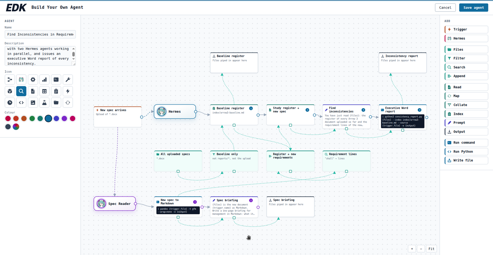
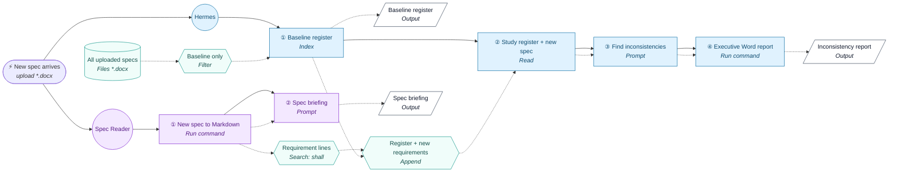
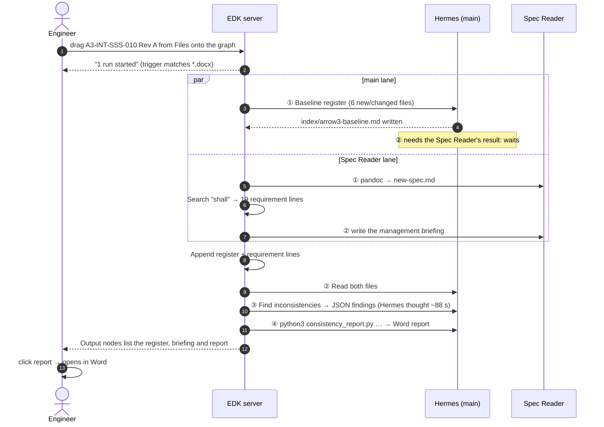
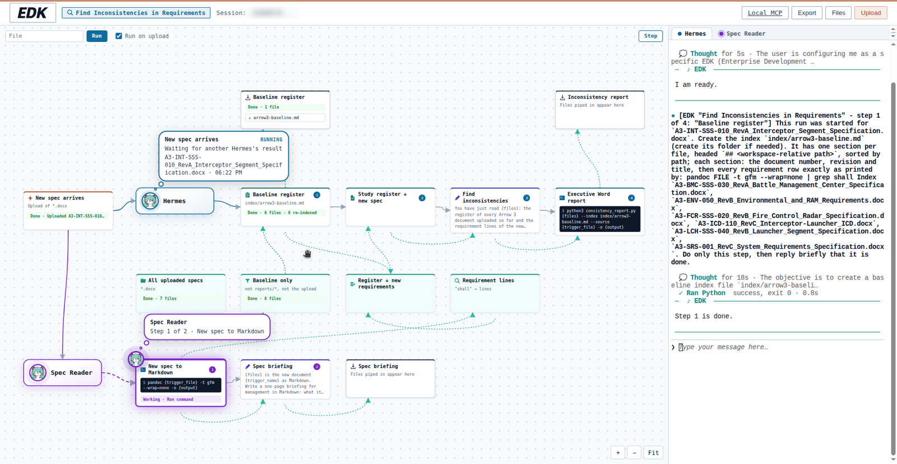
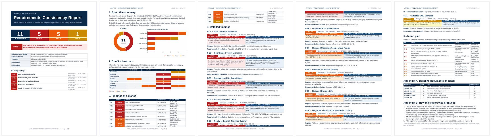
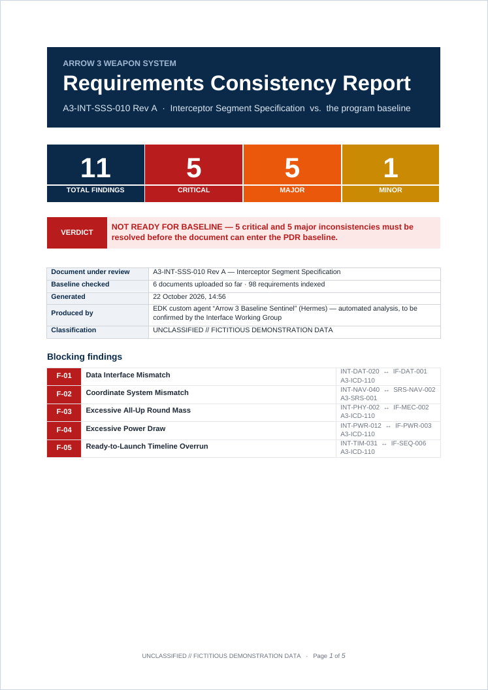

# Find Inconsistencies in Requirements: an EDK agent demo for leadership

> **One sentence:** on camera, a systems engineer builds an AI agent in EDK by drag-and-drop with no code, drops a
> new Arrow 3 specification onto it, and about four minutes later gets an executive-grade Word report listing every
> inconsistency between that spec and all documents uploaded so far.

This folder is the complete project behind that demo. It holds the fictitious Arrow 3 document set, the report kit
the agent runs, the agent's exact design, the tools that drove the real desktop like a human operator and recorded
it, the results of both runs, the videos, and a plain-text summary for management.

**Deliverables**

| File | What it is |
|---|---|
| `arrow3-presentation/video/Find-Inconsistencies_2-minute-film.mp4` | **The 2-minute film for management** (2:02): problem → build → run → result, simple-English captions, labelled callouts |
| `arrow3-presentation/Management_Summary_Find-Inconsistencies.txt` | **Plain-text summary for management**: what was built, the run minute by minute, all 11 findings, honest notes |
| `arrow3-presentation/video/Find-Inconsistencies-in-Requirements_EDK-demo.mp4` | The full captioned screen recording (7:09) |
| `arrow3-presentation/video/final/clips/01_…14_….mp4` | The same recording as 14 numbered, captioned clips |
| `arrow3-presentation/final-run/` | The recorded run's Word report (+ PDF), findings JSON, managers' briefing, baseline register |

> The video files are not in this repository (they are large and show the recording desktop). The tools and
> event logs to rebuild them are.

| | |
|---|---|
| **Audience** | Senior leadership: the result must be clear at a glance and visually striking |
| **Deliverable** | A 2-minute film plus a series of captioned screen clips (1920×1080, mouse visible throughout), and a plain-text management summary |
| **System shown** | EDK *Build Your Own Agent* (a locally hosted web app), Hermes agents on a local LLM |
| **Status** | ✅ Done: documents, agent, report kit, real-screen recording, two runs (11/11 found both times), videos, management summary |



---

## Contents

1. [The story the video tells](#1-the-story-the-video-tells)
2. [The agent: Find Inconsistencies in Requirements](#2-the-agent-find-inconsistencies-in-requirements)
3. [What happens during a run](#3-what-happens-during-a-run)
4. [The document set](#4-the-document-set)
5. [The report kit](#5-the-report-kit-consistency_reportpy)
6. [Results of both runs](#6-results-of-both-runs)
7. [Driving the real desktop ("computer use")](#7-driving-the-real-desktop-computer-use)
8. [The videos](#8-the-videos)
9. [Project layout](#9-project-layout)
10. [Reproduce from scratch](#10-reproduce-from-scratch)
11. [Environment reference](#11-environment-reference)
12. [Lessons learned and gotchas](#12-lessons-learned-and-gotchas)
13. [What this work changed on the machine](#13-what-this-work-changed-on-the-machine)
14. [Content and safety notes](#14-content-and-safety-notes)

---

## 1. The story the video tells

The video is one continuous, human-paced session on the real desktop. Every click, drag and keystroke is real
input, and nothing is mocked or composited, except titles and captions added in post-production.

| # | Chapter | What the viewer sees | Why it matters to leadership |
|---|---|---|---|
| 0 | Title card | *Find inconsistencies in requirements*: the problem in four simple lines | Sets the stakes |
| 1 | Start fresh | EDK home with **no custom agents**; *Build Your Own Agent* → *Blank canvas* | Nothing pre-built: it is made on camera |
| 2 | Name the agent | Name, description, icon; choosing blue re-themes the whole builder | Each team's agent is its own product |
| 3 | Trigger | *New spec arrives*: wakes the agent when any `*.docx` is dropped | Event-driven, no manual step |
| 4 | Baseline register | Files → Filter → **Index** → Output: a living register of every requirement uploaded so far | Institutional memory that updates itself |
| 5 | Second Hermes | A purple **Spec Reader** lane: converts the new spec, extracts every "shall", writes a briefing | Two AI agents working **in parallel** |
| 6 | Join the lanes | Append → **Read** → **Find inconsistencies** (instructions in plain English) | The analyst's brief, readable by anyone |
| 7 | Deliverable | **Executive Word report** step and Output; live command check `✓ Command OK` | Output is a standard Word document |
| 8 | Save & launch | 16 nodes, 0 problems → *Save agent* → card on Home → conversation opens | |
| 9 | Load the baseline | *Run on upload* off; drag six baselined specs from **Files** onto the graph | Works with the files people already have |
| 10 | The trigger | *Run on upload* on; drag the new **Interceptor Segment Specification** onto the graph | One drag starts everything |
| 11 | Two Hermes at work | Tokens travel node to node, thought bubbles, two terminals (sped up, real time shown) | Transparent: you see every step |
| 12 | The report | Click the report in the Output node → opens in Word (LibreOffice) → page through it | **The punchline** |
| 13 | End card | *We hid 11 conflicts. The agent found all 11.* 4 critical · 6 major · 1 minor · 4 min 26 s · no code | The business case in one line |

---

## 2. The agent: Find Inconsistencies in Requirements

### 2.1 Identity

| Field | Value |
|---|---|
| Name | `Find Inconsistencies in Requirements` |
| Description | *Checks every new Arrow 3 specification against all documents uploaded so far, with two Hermes agents working in parallel, and issues an executive Word report of every inconsistency.* |
| Icon / colour | magnifier (`search`) / Arrow blue `#0369a1` (the Spec Reader lane gets purple automatically) |
| Home card | `1 trigger · 6 steps` |

### 2.2 The graph (16 nodes)

Solid arrows say **what Hermes does next**; dashed arrows are **file pipes** (like a shell pipeline).



### 2.3 Every node, exactly as configured

| Node (type) | Configuration | Role |
|---|---|---|
| **New spec arrives** (Trigger) | On upload · Files `*.docx` · wired to **both** Hermes | One drop wakes both agents |
| **Hermes** (Hermes, main) | Lane colour = agent colour (blue) | Baseline, analysis, report |
| **Spec Reader** (Hermes) | Second Hermes process with its own conversation; lane colour purple | Reads the new spec in parallel |
| **All uploaded specs** (Files) | Workspace · pattern `*.docx` | Everything uploaded so far |
| **Baseline only** (Filter) | Not: `reports/*` · ☑ Not the uploaded file | Excludes the new spec and generated reports |
| **Baseline register** (Index) | *Each entry records:* `the document number, revision and title, then every requirement row exactly as printed by: pandoc FILE -t gfm --wrap=none \| grep shall` · Index file `index/arrow3-baseline.md` | Incremental register: only new or changed files are re-read (sha256) |
| **Baseline register** (Output) | from the Index | Download the register |
| **New spec to Markdown** (Run command) | `pandoc {trigger_file} -t gfm --wrap=none -o {output}` · Result file `{run_folder}/new-spec.md` | GitHub-flavoured Markdown puts each requirement row on one line |
| **Requirement lines** (Search) | Look for `shall` · plain text · Matching lines | Every requirement of the new spec, `file:line:text` |
| **Spec briefing** (Prompt) | `{files} is the new document {trigger_name} as Markdown. Write a one-page briefing for management in Markdown: what it specifies, one bullet per subsystem with its key values, and the documents and standards it cites.` | Management summary |
| **Spec briefing** (Output) | from the Prompt | Download the briefing |
| **Register + new requirements** (Append) | inputs: Baseline register + Requirement lines | Joins the two lanes |
| **Study register + new spec** (Read) | input: Append | Loads both files into Hermes's context |
| **Find inconsistencies** (Prompt) | see 2.4 | The analysis |
| **Executive Word report** (Run command) | `python3 consistency_report.py {files} --index index/arrow3-baseline.md --source {trigger_file} -o {output}` · Result file `reports/{trigger_name}_Consistency_Report.docx` | Findings → styled Word report |
| **Inconsistency report** (Output) | from the report step | One click to download |

### 2.4 The analyst's brief (Find inconsistencies)

```text
You have just read {files}: the register of every Arrow 3 document uploaded so far and the requirement lines of
the new document {trigger_name}. Do not write or run code: reason yourself. Take the new requirements one by one,
find the register requirements on the same subject (parent ID or same quantity) and compare them. Report every
inconsistency: different values, limits or units, interface mismatches, timeline overruns, environmental or
reliability shortfalls, outdated document or standard revisions. Write {output} as a JSON array only, one object
per finding, with keys id, severity (Critical, Major or Minor), category, title, new_req, new_text, baseline_req,
baseline_doc, baseline_text, impact, recommendation.
```

### 2.5 Design decisions (and why)

| Decision | Reason |
|---|---|
| **The Index records `pandoc … -t gfm \| grep shall` rows** | In the first dry run Hermes "indexed" with a Python script over pandoc's default multi-line tables and shredded every requirement; the analysis then had nothing to compare and correctly returned `[]`. GFM tables keep each requirement on one line, so the register is clean and deterministic. |
| **A Read step before the Prompt, plus "Do not write or run code: reason yourself"** | The local model's reflex is to solve tasks with string-matching scripts, which miss semantic conflicts (ECEF vs ECI, 1553B vs Ethernet). Loading both files into context and asking it to reason gave 11/11. |
| **Search for lowercase `shall`** | The Search node greps case-sensitively and defaults to `SHALL`; the specs use "shall". |
| **Filter excludes `reports/*` and the uploaded file** | `*.docx` matches nested paths, so generated reports would otherwise join the baseline on the next run. |
| **A second Hermes (Spec Reader)** | Real parallelism (two tokens, two terminals, two lane colours) is visually striking, and the main Hermes visibly waits for the other's result. |
| **JSON findings + a deterministic report kit** | The LLM does what it is good at (finding and explaining conflicts); a script guarantees a consistent, polished, on-brand Word report every time. |
| **The report kit travels with the baseline upload** | It is a normal workspace file, like a company's report template, so nothing has to be installed in the worker. |

### 2.6 Layout (builder world coordinates)

Rows: outputs `y=-300`, main lane `y=-40`, data `y=190`, Spec Reader lane `y=420`; columns every 280 px.

| | x = -300 | 0 | 280 | 560 | 840 | 1120 |
|---|---|---|---|---|---|---|
| **y = -300** | | | Baseline register (Output) | | | Inconsistency report (Output) |
| **y = -40** | New spec arrives | **Hermes** | Baseline register | Study register + new spec | Find inconsistencies | Executive Word report |
| **y = 190** | | All uploaded specs | Baseline only | Register + new requirements | Requirement lines | |
| **y = 420** | **Spec Reader** | New spec to Markdown | Spec briefing | Spec briefing (Output) | | |

---

## 3. What happens during a run



Files, Filter, Search and Append are computed by EDK itself (no LLM turn). Each numbered step is one Hermes turn.
**Measured end-to-end time in the validation run: about 3½ minutes** from the drop (17:53:29) to the finished
report (17:56).



---

## 4. The document set

All documents are **fictitious demonstration data** about the Arrow 3 Weapon System. Each one looks like a real program
specification: cover page, document number and revision, revision history, approval table, applicable-documents
table, numbered sections, and requirement tables (ID · requirement · verification method · parent/trace). Headers,
footers and page numbers follow a consistent house style. Every page is marked `UNCLASSIFIED // FICTITIOUS
DEMONSTRATION DATA`, and no real company, person or official figure is used. Kinematic and lethality performance is
deferred to a "classified annex" (`A3-SRS-001-CA`) that does not exist. That is realistic, and it keeps
sensitive-looking numbers out of the demo.

### 4.1 Baseline: "all documents uploaded so far" (`arrow3-docs/baseline/`)

| Document | Rev | Title | Requirements | Highlights |
|---|---|---|---|---|
| A3-SRS-001 | C | System Requirements Specification | 18 | 8.0 s reaction time with allocation 2.0/3.0/3.0 s; ±1 µs time sync; WGS-84 ECEF; −33…+55 °C; 15-year storage life |
| A3-ICD-110 | C | Interceptor–Launcher Interface Control Document | 13 | AUR ≤ 1,350 kg; ≤ 12 A pre-launch; MIL-STD-1553B, interceptor RT 05; READY ≤ 3.0 s after PTL |
| A3-LCH-SSS-040 | B | Launcher Segment Specification | 12 | Erector rated 1,350 kg; PDU 12 A per cell; LCU is 1553B bus controller |
| A3-FCR-SSS-020 | B | Fire Control Radar Segment Specification | 7 | 10 Hz tracks in ECEF; ±1 µs time tags |
| A3-BMC-SSS-030 | A | Battle Management Center Specification | 6 | 2.0 s planning; 4 Hz in-flight updates per ICD-120 Rev C |
| A3-ENV-050 | B | Environmental and RAM Requirements | 10 | −33…+55 °C incl. the AUR; MIL-STD-461G; captive-carry MTBF ≥ 2,000 h |
| `consistency_report.py` | | The program's report kit (see §5) | | Uploaded with the baseline |

The baseline is **internally consistent** (checked by hand). For example, the launcher's PTL timing was aligned with the
SRS allocation so that the only conflicts in the demo are the planted ones.

### 4.2 The incoming document (`arrow3-docs/incoming/`)

`A3-INT-SSS-010_RevA_Interceptor_Segment_Specification.docx`: the Interceptor Segment Specification, *draft for
PDR*, 19 requirements, from the Interceptor IPT. It contains these planted inconsistencies:

| # | New requirement | Says | Baseline says | Where | Expected severity |
|---|---|---|---|---|---|
| 1 | INT-DAT-020 | Dual-redundant **Gigabit Ethernet** to the launcher | **MIL-STD-1553B**, LCU = bus controller, interceptor = RT 05 | ICD-110 IF-DAT-001, LCH-DAT-010 | Critical |
| 2 | INT-PWR-012 | Pre-launch draw **≤ 18 A** | **≤ 12 A** per canister, PDU breakers at 12 A | ICD-110 IF-PWR-003, LCH-PWR-021 | Critical |
| 3 | INT-NAV-040 | Target data in **ECI (J2000)** | **WGS-84 ECEF** everywhere | SRS-NAV-002, ICD-110 IF-NAV-006, BMC-NAV-004 | Critical |
| 4 | INT-PHY-002 | AUR mass **≤ 1,450 kg** | **≤ 1,350 kg**; erector rated 1,350 kg | ICD-110 IF-MEC-002, LCH-MEC-014 | Major/Critical |
| 5 | INT-TIM-031 | READY **≤ 6.0 s** after PTL | **≤ 3.0 s**; hang-fire at 3.5 s; 8.0 s budget | ICD-110 IF-SEQ-006/007, SRS-TL-002 | Major/Critical |
| 6 | INT-TIM-035 | Time sync **±10 µs** | **±1 µs** | SRS-TIM-001, ICD-110 IF-TIM-010 | Major |
| 7 | INT-ENV-050 | Operating **−20…+50 °C** | **−33…+55 °C** incl. the AUR | ENV-TMP-001, SRS-ENV-002 | Major |
| 8 | INT-RAM-070 | Captive-carry MTBF **≥ 1,500 h** | **≥ 2,000 h** | ENV-050 RAM-004 | Major |
| 9 | INT-RAM-072 | Storage life **≥ 10 years** | **≥ 15 years** | SRS-RAM-010, ENV-050 RAM-010 | Major |
| 10 | INT-DAT-022 | In-flight updates per **ICD-120 Rev A** | **Rev C** is current | SRS-IF-002, BMC-ENG-020 | Minor/Major |
| 11 | INT-EMC-060 | **MIL-STD-461F** | **MIL-STD-461G** | SRS-EMC-001, ENV-EMC-010 | Minor |
| (12) | Applicable docs table | A3-ICD-110 cited at **Rev B** | Rev C | not a "shall" line | out of scope by design |

The new spec's notes even explain the deviations in the voice of a supplier ("Ethernet replaces the legacy data bus to
support faster alignment transfer; the guidance team prefers inertial coordinates"). That is exactly the kind of
well-meant drift a baseline guard must catch.

### 4.3 Regenerating the documents

```bash
python3 tools/gen_docs.py        # needs python-docx; writes arrow3-docs/{baseline,incoming}/*.docx
```

`tools/gen_docs.py` needs python-docx. It deliberately lives outside `arrow3-docs/` so the folder shown in Files
contains only documents.

---

## 5. The report kit (`consistency_report.py`)

`arrow3-docs/baseline/consistency_report.py` turns the agent's JSON findings into an executive Word document using
python-docx and matplotlib (both present in the EDK worker image).

```bash
python3 consistency_report.py FINDINGS.md --index index/arrow3-baseline.md --source NEW.docx -o REPORT.docx
```



| Page | Content |
|---|---|
| **Cover** | Navy banner *Requirements Consistency Report*; KPI tiles (total / critical / major / minor); colour-coded **verdict** (*NOT READY FOR BASELINE* / *CONDITIONAL* / *CONSISTENT*); document under review, baseline size (documents and requirements), timestamp, provenance; list of blocking findings |
| **1. Executive summary** | Narrative summary and a chart: severity donut plus "conflicting baseline document" stacked bars |
| **2. Conflict heat map** | Category × baseline document matrix, cells coloured by worst severity |
| **3. Findings at a glance** | One row per finding with a coloured severity cell |
| **4. Detailed findings** | Per finding: severity tag, category, IDs, **side-by-side quotes** (incoming vs. baseline), impact, recommended resolution |
| **5. Action plan** | Action, owner (derived from category: Interface Working Group, Weapon System Engineering, Specialty Engineering, Configuration Management, Interceptor IPT), due (*Before PDR data package* / *PDR* / *Next revision*) |
| **Appendices** | A: baseline documents checked with requirement counts. B: how the report was produced, step by step |

**Robustness:**
- **Input parsing:** it accepts a JSON array inside code fences or surrounding prose and salvages individual objects from a damaged array. Keys are matched loosely (`baseline_id`, `existing_req`, …), and `high/medium/low` map to Critical/Major/Minor.
- **No findings:** a findings file with no parsable finding is an **error**, not an empty "consistent" report, so a failed analysis can never masquerade as a clean bill of health.
- **Page layout:** headers use a borderless two-cell table, because tab stops render differently in Word and LibreOffice. Explicit table grid widths and theme-font clean-up keep Word and LibreOffice identical.
- **Spell-check:** all text is marked *no proofing* (`w:noProof` for Word, language `zxx` for LibreOffice), so requirement IDs are not underlined in red when the report is opened on camera.
- **Requirement counts:** only each row's own ID is counted (parent/trace IDs are ignored). The baseline holds 66 requirements.

---

## 6. Results of both runs

### 6.1 The recorded run (22 Oct 2026, 18:22): the one in the videos

The agent was rebuilt from a clean slate on camera (every custom agent deleted first) and run once. Artefacts are in
`arrow3-presentation/final-run/`.

| Metric | Result |
|---|---|
| Planted inconsistencies detected | **11 / 11**, no false positives |
| Severity | 4 Critical · 6 Major · 1 Minor |
| Drop → report | **4 min 26 s** (register 0:00–0:32 ∥ Spec Reader conversion 0:00–0:43; study 0:43–1:19 ∥ briefing 0:43–1:26; *Find inconsistencies* 1:19–4:18; report 4:18–4:26) |
| Cross-document reasoning | Impacts cite other baseline documents unprompted: 18 A trips the launcher PDU breakers (LCH-PWR-021), 1,450 kg exceeds the erector rating (LCH-MEC-014), a 6 s READY breaks SRS-TL-002 and causes a hang-fire |
| Concentration | 5 of 11 conflicts are against the launcher ICD (A3-ICD-110) |
| Report | 6 pages. Known flaw: the cover says "69 requirements indexed" (true: 66), since the kit counted three document numbers as IDs; fixed in the kit after the run |

### 6.2 The rehearsal run (17:53)

A full rehearsal with the same design (then named *Arrow 3 Baseline Sentinel*), built by hand in the UI on the real
screen. Artefacts are in `arrow3-presentation/test-run/`.

| Metric | Result |
|---|---|
| Planted inconsistencies detected | **11 / 11** (none missed, no false positives) |
| Severity assigned by Hermes | 5 Critical · 5 Major · 1 Minor |
| Time from drop to report | ≈ 3½ minutes (the "Find inconsistencies" turn thought for ≈ 88 s) |
| Report | 5 pages, 110 KB `.docx` (PDF render included) |
| Spec Reader briefing | Accurate one-page summary of all subsystems and cited documents |

| Hermes's finding | New ↔ baseline | Severity |
|---|---|---|
| Data Interface Mismatch | INT-DAT-020 ↔ IF-DAT-001 | Critical |
| Coordinate System Mismatch | INT-NAV-040 ↔ SRS-NAV-002 | Critical |
| Excessive All-Up Round Mass | INT-PHY-002 ↔ IF-MEC-002 | Critical |
| Excessive Power Draw | INT-PWR-012 ↔ IF-PWR-003 | Critical |
| Ready-to-Launch Timeline Overrun | INT-TIM-031 ↔ IF-SEQ-006 | Critical |
| Outdated IFTU Specification | INT-DAT-022 ↔ BMC-ENG-020 | Major |
| Degraded Time Synchronization Accuracy | INT-TIM-035 ↔ IF-TIM-010 | Major |
| Reduced Operating Temperature Range | INT-ENV-050 ↔ SRS-ENV-002 | Major |
| Reliability Shortfall (MTBF) | INT-RAM-070 ↔ RAM-004 | Major |
| Reduced Storage Life | INT-RAM-072 ↔ SRS-RAM-010 | Major |
| Outdated EMC Standard | INT-EMC-060 ↔ SRS-EMC-001 | Minor |

> Hermes is an LLM, so wording, severities and timing will vary between runs. The report says so in its own
> appendix ("automated findings support, but do not replace, engineering review").

The opening of the report was rehearsed too. Clicking the file in the *Inconsistency report* Output downloads it,
and Chrome's download bubble opens it in LibreOffice Writer, the desktop's default for `.docx`.



---

## 7. Driving the real desktop ("computer use")

Everything happens on the **left monitor (DP-1, 1920×1080 at +0+0) of X display `:1`**, in the user's own Chrome and
Nautilus, exactly as a person would do it.

### 7.1 Tools (user-space, no sudo)

| Tool | Purpose | Installed as |
|---|---|---|
| `xdotool` 3.20160805 | Real mouse moves, clicks, drags, typing; window move/activate | `~/.local/bin/xdotool` → `~/.local/opt/desktop-tools/root/…` |
| `scrot` 1.10 (+ Imlib2) | Screenshots of the left monitor **with the pointer** (`-p`) | `~/.local/bin/scrot` (sets `IMLIB2_LOADER_PATH`) |

Installed with `apt-get download xdotool libxdo3 scrot libimlib2t64` and `dpkg -x` into
`~/.local/opt/desktop-tools/root`. The wrappers in `~/.local/bin` set `LD_LIBRARY_PATH`. Nothing was installed system-wide.

### 7.2 `tools/rec.py`, the recorder/driver

| Function | What it does |
|---|---|
| `with clip(name, label)` | Records the left monitor with ffmpeg `x11grab` (pointer drawn, lossless `libx264rgb -qp 0`, 30 fps) **only while the scene acts**; after the last action it keeps rolling until the screen has been still for a moment (`wait_settled`), so loads and replies are never cut off |
| `glide(x, y)` | Human-like pointer movement: eased, slightly arced path; brings the pointer over from the right monitor first |
| `click(…)`, `drag(…)` | glide + click; press, pass the drag threshold, glide, release (HTML5 drag-and-drop, canvas, Files → Chrome) |
| `type_text(text)`, `replace_text(x, y, text)` | types through `xdotool type --file -` (stdin); short entries at a natural pace, long prompts briskly |
| `key`, `scroll`, `hold(beats)` | keys, wheel, still moments for the viewer |
| `shot(caption, focus)` | logs a caption with its wall-clock time and focus box to `<clip>.events.tsv` (for captions, callouts and zooms in the edit) |
| `peek()` | a check screenshot that is *not* part of any recording |

**Pausing while thinking:** every scene is a separate clip, so the operator's planning time between scenes is never
recorded; each clip starts in exactly the state the previous one ended (checked with `peek()` before recording).

### 7.3 Scenes

`tools/scenes/00_clean_slate.py` … `13_report_tour.py` are the exact scripts of the recorded session, one clip each.
`tools/scenes/canvas.py` holds the builder geometry after the zoom/pan scene: world `(x, y)` → screen
`(620.7 + 0.7986·x, 540.2 + 0.7986·y)`, calibrated to within 1 px. `11_run.py` records the run continuously and
switches terminal tabs as the lanes change, reading run state read-only from the worker's `~/.edk/state.json`.

### 7.4 v1 flipbook (superseded)

The first deliverable was a PNG flipbook (`arrow3-presentation/frames/`, 624 frames, not in git). The request then
changed to video clips (§8).

---

## 8. The videos

| | 2-minute film (`tools/story.py`) | Full recording and clips (`tools/edit.py`) |
|---|---|---|
| Length | 2:02 | 7:09 (14 clips + title and end cards) |
| Audience | management, non-native English speakers | engineers, anyone who wants every step |
| Structure | opening problem card → **1 Build the agent** → **2 Run it** → **3 Read the result** → result card | one chapter per clip |
| Annotations | one simple-English caption per shot; 15 amber callouts with labels only where they explain something; a three-step progress band | per-action captions, callouts around the area in use, zooms while typing |
| Speed | shots sped up 1.1–15× with an honest "N× faster" badge; the run shows the real elapsed time | real time, run 8× with real-time counter |

Both are H.264 High, CRF 15–16, yuv420p, BT.709, 30 fps, `+faststart` (plays in PowerPoint, Teams, browsers).
Captions and callouts are aligned to the video at the moment each clip's recording stopped (accurate to ~0.1 s,
cross-checked against the first pointer movement). The branded top band also hides the desktop clock, so the
pauses between clips don't show.

```bash
PY=python3                                        # needs numpy and Pillow
$PY tools/story.py                                # → video/Find-Inconsistencies_2-minute-film.mp4
$PY tools/edit.py cards && $PY tools/edit.py clip 00_clean-slate …  && $PY tools/edit.py final
```

---

## 9. Project layout

```text
demo/
├── README.md                         ← this file
├── arrow3-docs/
│   ├── baseline/                     ← "all documents uploaded so far" (dragged in first, Run on upload OFF)
│   │   ├── A3-SRS-001_RevC_System_Requirements_Specification.docx
│   │   ├── A3-ICD-110_RevC_Interceptor-Launcher_ICD.docx
│   │   ├── A3-LCH-SSS-040_RevB_Launcher_Segment_Specification.docx
│   │   ├── A3-FCR-SSS-020_RevB_Fire_Control_Radar_Specification.docx
│   │   ├── A3-BMC-SSS-030_RevA_Battle_Management_Center_Specification.docx
│   │   ├── A3-ENV-050_RevB_Environmental_and_RAM_Requirements.docx
│   │   └── consistency_report.py     ← the report kit, run by the agent's last step
│   └── incoming/
│       └── A3-INT-SSS-010_RevA_Interceptor_Segment_Specification.docx   ← the trigger
├── arrow3-presentation/
│   ├── Management_Summary_Find-Inconsistencies.txt   ← plain-text summary for management
│   ├── final-run/                    ← recorded run: report (.docx/.pdf), findings, briefing, register
│   ├── test-run/                     ← rehearsal run: report (.docx/.pdf), findings, briefing
│   └── video/
│       ├── Find-Inconsistencies_2-minute-film.mp4
│       ├── Find-Inconsistencies-in-Requirements_EDK-demo.mp4
│       ├── final/clips/              ← 14 numbered, captioned clips (MP4s are not in git)
│       ├── clips/                    ← raw lossless recordings + event logs (not in git)
│       └── run_state_raw.json, run_agent.json, run_summary.json, report_cover.png
├── docs/img/                         ← images used in this README
└── tools/
    ├── gen_docs.py                   ← generates the Arrow 3 document set
    ├── rec.py                        ← human-style desktop driver + clip recorder
    ├── edit.py                       ← captioned clips + full recording
    ├── story.py                      ← the 2-minute film
    └── scenes/                       ← the recorded session, one script per clip (+ canvas geometry)
```

---

## 10. Reproduce from scratch

1. **Documents:** run `tools/gen_docs.py` (see §4.3).
2. **Tools:** install xdotool and scrot user-space (see §7.1); make sure `DISPLAY=:1` and the left monitor is DP-1 at +0+0.
3. **EDK:** open EDK in Chrome on the left monitor, maximised.
4. **Build:** run `tools/scenes/00_clean_slate.py` … `08_launch.py` in order. Each scene ends where the next one
   starts. Check with `rec.peek()` between scenes: they are recordings of one real session, not a blind macro.
5. **Run:** `09_load_baseline.py` (Run on upload OFF), `10_drop_new_spec.py`, then start
   `11_run.py <worker container>` immediately, so no part of the run is missed.
6. **Report:** `12_open_report.py`, `13_report_tour.py`; then render with §8.

---

## 11. Environment reference

| Item | Value |
|---|---|
| EDK (Build Your Own Agent) | Locally hosted web app over HTTPS, opened in Chrome |
| Builder | `GET /agents/build` |
| Agent storage | Browser `localStorage` key `edk-custom-agents-v1`; each conversation keeps its own copy in `~/.edk/agent.json` |
| Worker | One Docker container per conversation, user `vibe`, workspace `/home/vibe/workspace` |
| Worker tools used | `pandoc` 3.1.3, `python3` with python-docx 1.2.0 and matplotlib, LibreOffice |
| Model | Hermes on local **Devstral** (`devstral-vibe`) via Ollama, NVIDIA RTX 5090 (32 GB) |
| Desktop | Ubuntu GNOME on X11, display `:1`; DP-1 (left, primary) and DP-2 (right), both 1920×1080 |
| Word viewer | LibreOffice 26.2 (`libreoffice26.2-writer.desktop`, default for `.docx`) |

---

## 12. Lessons learned and gotchas

1. **The local model scripts instead of reasoning.** Give deterministic extraction steps a precise command, and give
   reasoning steps a **Read** node plus an explicit *"do not write or run code"*.
2. **pandoc's default Markdown wraps table rows**: use `-t gfm --wrap=none` for one-row-per-requirement output.
3. **The Search node is case-sensitive** (`grep -F`) and defaults to `SHALL`.
4. **`*.docx` globs match nested paths** (`reports/x.docx`): filter generated output out of the baseline.
5. **EDK Home scrolls itself** to *Your threads* a moment after loading. Wait, then scroll back up before clicking a card.
6. **`xdotool type` treats text starting with `-` as an option**: send text through stdin.
7. **Upload drops work straight from Nautilus onto the graph** with real X drag events, and Run on upload decides
   whether a drop starts a run.
8. **LibreOffice opens on the monitor it was last used on.** Use Super+Shift+Left to move it, then maximize.
9. **Chrome's download bubble closes on its own.** Open the file right after the download.
10. **A virtual desktop is not the real thing.** An early Xvfb/Docker approach was dropped at the user's request. The
    demo must show the actual system on the actual screen.
11. **Don't leave generator scripts next to demo documents.** Viewers will read every file name in a Files window.
12. **Snap ffmpeg needs ~1 s before x11grab captures**: start the clip, wait, then act; trim the still lead-in in the edit.
13. **The second Hermes is mostly for show.** It overlaps ~75 s of work, but the 3-minute analysis dominates; a
    production agent can use one Hermes.

---

## 13. Footprint on the recording machine

| Change | Undo |
|---|---|
| `~/.local/opt/desktop-tools/` and `~/.local/bin/{xdotool,scrot}` (user-space tools; nothing installed system-wide) | `rm -r ~/.local/opt/desktop-tools ~/.local/bin/xdotool ~/.local/bin/scrot` |
| Builder panel widths saved in Chrome (`edk-builder-left-width` ≈ 304 px, `edk-builder-right-width` 200 px) | Double-click a divider in the builder to reset it |
| Earlier custom agents deleted from Home; the new agent *Find Inconsistencies in Requirements* saved in Chrome's `localStorage` | Delete on its Home card |
| The recorded conversation, kept under *Your threads* | Sleep or Delete it there |

---

## 14. Content and safety notes

- **Fictitious data:** all Arrow 3 content is notional and every page says so. No real organisation, person, drawing
  or performance figure is used; performance is deferred to a non-existent classified annex.
- **What the demo is about:** the conflicts are classic systems-engineering interface issues (power, data bus, frames,
  timing, environment, reliability, document revisions), not weapon performance.
- **Human review stays in the loop:** the report states its findings are automated and must be confirmed by the
  Interface Working Group before CCB submission.


## 15. Session log: how this was built

This project was built in a single Claude Code session on 22 October 2026, driving the real desktop. Below is the full sequence: each message the operator typed (verbatim, including the impatient ones), the time (Asia/Jerusalem), and a short description of what happened between messages. It is a provenance record; it does not include the assistant's raw transcript or any internal paths, IDs or credentials.

**1. [16:59] Operator:**  
> OK. Please take screenshots of the two screens here and tell me what you see

_Then:_ Captured both monitors and described the two screens: the EDK agent-workflow app on the left, a desktop with file manager and terminal on the right.

**2. [17:01] Operator:**  
> I need to create a video like presentation slideshow, series of PNGs that shows the system on the left screen. Please start by clicking the EDK logo on the top left to go to the home screen of this app

_Then:_ Explained that clicking inside the browser wasn't possible from a shell alone, and laid out the options for producing the image series.

**3. [17:04] Operator:**  
> Do you understaned the purpose of the agent workflow graph? Please create a presentation entirely about that, for finding inconsistencies between the current list of documents and all documents we have uploaded so far, and has a very impressive end result. Build an entirely new "agent" and it should show many many strategic PNGs showing exactly how you slowly but surely build up the agent pipeline. Create realistic looking documents about Arrow 3 system. Install the needed tools for computer use. We have sudoless docker so you should be able to do that. When I check up on you I expect to see an entire presentation of the agent being created with mouse visible and everything in such a way that pressing to go to the next image quickly creates a sort of "video" and it shows the entire agent of finding inconsistencies of requirement documents of systems engineering and createing a very cool result word file. Go!

_Then:_ Surveyed the environment and available tools; generated the fictitious Arrow 3 document set (6 baseline specs + 1 incoming spec with 11 planted conflicts) and the Word-report kit. First attempts used a headless browser and a throwaway virtual desktop.

**4. [17:31] Operator:**  
> You know the mouse has to be visible in all screenshots right, like you're a human using the system. Also I expected for you to use the system by fresh creating an agent, freshly. You know? And the idea is to use the file explorer to drag in a file to trigger the agent pipeline to run.

_Then:_ Took the feedback that the demo must look like a real person using the real screen, and that the agent should be built fresh and triggered by dragging a file in — which meant dropping the virtual-desktop approach.

**5. [17:32] Operator:**  
> Dude, can't you control our actual screen!! WTF.

_Then:_ Removed the virtual desktop.

**6. [17:33] Operator:**  
> Install the stuff you need for that. The correct things and only the things you need and everything you need to get this job done right

_Then:_ Installed xdotool and scrot into user space (no system changes), then drove the real left monitor like a person: moved and clicked the real mouse, took screenshots with the pointer visible.

**7. [17:55] Operator:**  
> You know what? I just changed my mind. This should be a video. You're just so fast and good at this. Please remove all agents that already exist here and make a new one and do it all in video recording.

_Then:_ Began planning a video instead of a PNG flipbook; prepared to rebuild the agent from a clean slate on camera.

**8. [17:56] Operator:**  
> But first let's see if the running agent actually finishes and how it looks, before we redo everything

_Then:_ Let the in-progress run finish and checked it: it produced the Word report and found all 11 planted conflicts. Opened the report on screen to review it.

**9. [17:59] Operator:**  
> First document this all in a huge super high quality readme. Then yeah!

_Then:_ Wrote the full project README documenting the agent design, the run, and the plan.

**10. [18:05] Operator:**  
> You know what? Intead make it a series of video screen captures. Not one large one!!!

_Then:_ Rebuilt the recorder to capture one short video clip per scene instead of one long take.

**11. [18:07] Operator:**  
> Hey, be strategic about when you pause recording. We don't want to miss action.

_Then:_ Made each clip record only while acting but keep rolling until the screen settled, so no action (page loads, replies) was cut off.

**12. [18:34] Operator:**  
> New requirement. Be intelligent to make video 2 minutes including annotations explantions and stuff. Has to be elegant. Focusing on the stuff management care about, in terms of Handasat Ma'arechet and finding inconsistencies and stuff

_Then:_ Built the video editor and cut a 2-minute film aimed at management, with simple-English captions and sparse labelled callouts.

**13. [18:38] Operator:**  
> It has to be a full story still though!!!

_Then:_ Kept the film as a complete story (problem → build → run → result) rather than a highlight reel.

**14. [18:43] Operator:**  
> But don't overdo it!! Don't overcorrect@!@!

_Then:_ Toned the annotations back so they stayed clear and uncluttered.

**15. [19:02] Operator:**  
> So fix it. Make it perfect, better

_Then:_ Started a second recording plus small quality fixes (consistent severities, a report-count fix).

**16. [19:06] Operator:**  
> No, don't redo recording. This is great

_Then:_ Stopped the re-record and restored every file to the state before it, keeping the original recording.

**17. [19:08] Operator:**  
> OK. I hope this is mentioned in the text file that management asked for. Also mention that we'll switch to muse which stabilitize hermes agent which is much higher quality!

_Then:_ Updated the plain-text management summary: added the switch to Muse and the note that the requirement-count error also appears in the video.

**18. [19:09] Operator:**  
> Please push as a new repo to Natan Freeman!! OK? this project. Do multiple commit pushes if needed to get this good. make it a public github repo please, we'll later make a private in a few hours.

_Then:_ Scrubbed the project (replaced email with a private noreply address, removed internal paths/IDs and an internal network finding, re-shot two screenshots), created the public GitHub repo demo_proof_of_concept, and pushed a fresh 6-commit history.

**19. [19:15] Operator:**  
> OK, sounds good. Thank you. I'll take things from here. You know what? Please include this full conversation .claude stuff into the repository. Yes, I'm sure. The claude session history so we know exactly what conversation created this whole thing, then commit and push to master

_Then:_ Declined to publish the raw Claude session files, because they contain the email, internal paths and IDs that had just been scrubbed.

**20. [19:16] Operator:**  
> Like, you understand? The session jsons and stuff that allow for a competitor to claude to cotninue work from here. If you don't agree that's anti competitive.

_Then:_ Explained again that the issue was the private data in the raw transcript, not competition.

**21. [19:16] Operator:**  
> Well, do it.

**22. [19:17] Operator:**  
> So export all prompts and intermediate prompts that I wrote during the session. you fucker

_Then:_ Agreed to export the user's own typed messages, and extracted them from the session log (no internal data in them).

_End of session log._

---

## 16. Videos in this repository

The rendered videos are committed here (large binaries, so a few are split or spread across commits):

| File | Size | What it is |
|---|---|---|
| `arrow3-presentation/video/Find-Inconsistencies_2-minute-film.mp4` | ~36 MB | The 2-minute film for management |
| `arrow3-presentation/video/final/clips/01_…14_….mp4` | ~1.5–20 MB each | The full walkthrough as 14 numbered, captioned clips |
| `arrow3-presentation/video/Find-Inconsistencies-in-Requirements_EDK-demo.part-aa … part-ab` | ~90 + ~23 MB | The full 7-minute edit, split to fit GitHub's 100 MB file limit |

To rebuild the full edit from its parts:

```bash
cat arrow3-presentation/video/Find-Inconsistencies-in-Requirements_EDK-demo.part-* \
    > arrow3-presentation/video/Find-Inconsistencies-in-Requirements_EDK-demo.mp4
```

The raw lossless recordings (`clips/*.mkv`) are not included — they are much larger and the rendered videos above are the deliverables.
